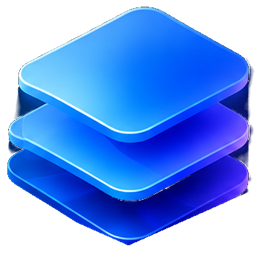

  

<h1 align="center">FocusList</h1>

<strong>Organização pessoal com foco no que realmente importa.</strong>

    
    
    
    
    
    
    
    

  <a href="https://focus-list-nine.vercel.app"><strong> Acessar o FocusList em produção</strong></a>

## Sobre

O **FocusList** é uma aplicação web responsiva para organizar atividades na hierarquia **Áreas → Listas → Tarefas**. A experiência combina planejamento direto, visão clara das prioridades e acompanhamento do progresso em uma interface dark minimalista para desktop, mobile e PWA.

## Destaques

- Dashboard responsivo com progresso, prioridades e próximos prazos;
- Áreas, Listas e Tarefas com checklist, links, visualizações e arquivamento;
- autenticação segura, recuperação de senha e isolamento entre usuários;
- modo Demonstração temporário, com opção de importar os dados ao criar uma conta;
- Perfil com preferências e avatar armazenado em bucket privado;
- PWA instalável com experiência Offline própria, sem cache de dados privados.

## Stack

| Camada | Tecnologias |
| --- | --- |
| Frontend | React 19, TypeScript, Vite 6, React Router e CSS próprio |
| Backend | Node.js, Express 5 e arquitetura Route → Controller → Service → Repository |
| Dados | Prisma 7, PostgreSQL e Supabase Storage privado |
| Serviços | Resend para recuperação de senha |
| Produção | Vercel, com frontend estático e API Express na mesma origem |

## Documentação

A arquitetura, regras de negócio, fluxos e decisões de produto estão centralizados na [documentação oficial](docs/00-indice.md).

---

  
   
  Desenvolvido por
   
  <strong>Isaac Gabriel</strong>
    
  
  

